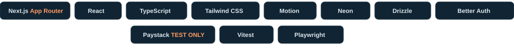
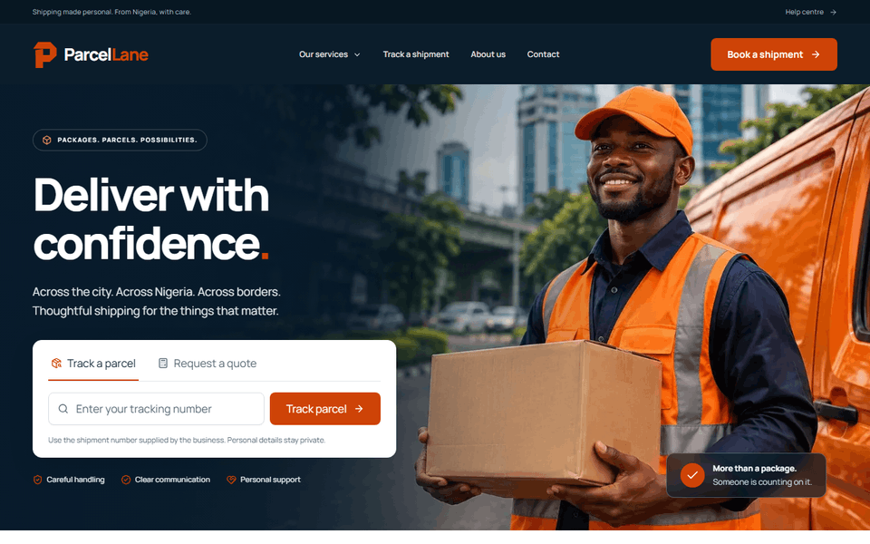
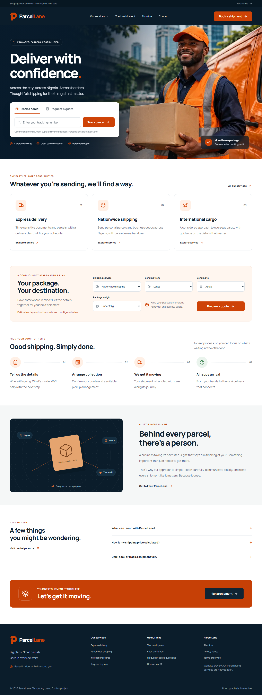
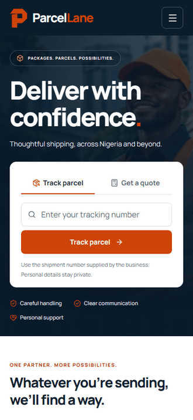
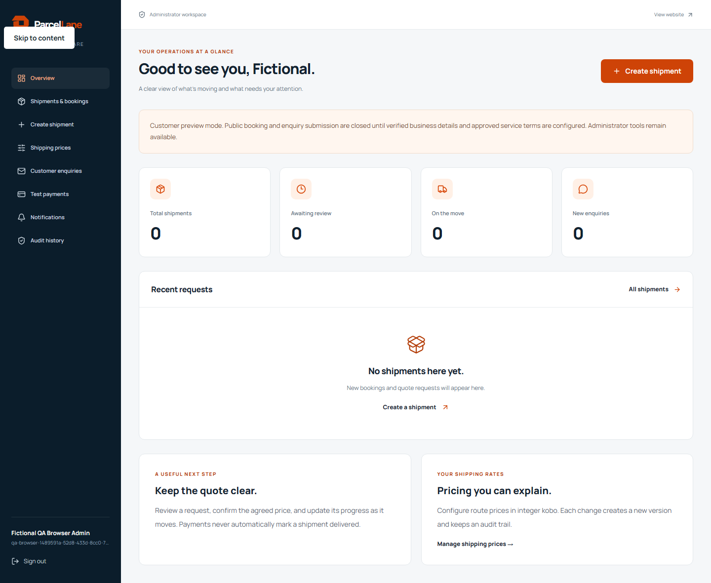
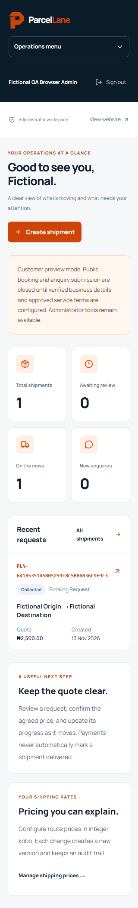
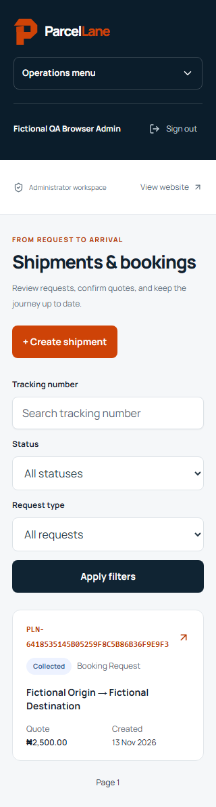
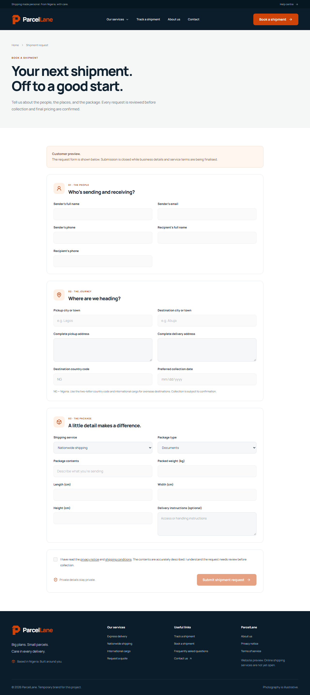
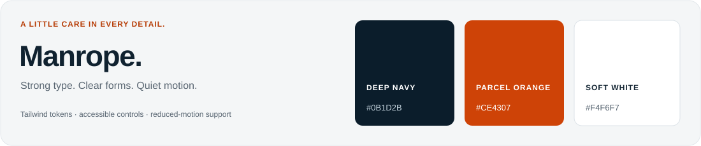

<div align="center">



**Good shipping starts with a little care.**

A modern shipping and cargo website, from the first quote to the final delivery update.

[**Open the customer preview ↗**](https://parcellane-cargo-preview.vercel.app) · [Administrator login](https://parcellane-cargo-preview.vercel.app/admin/login) · [Setup guide](docs/SETUP.md) · [CSS showcase](docs/readme/index.html)



</div>

> **Customer preview.** ParcelLane is a temporary brand. Public bookings, enquiries, payments, and outgoing emails are disabled while business details are finalised. Use fictional demonstration data only.

## Take a look

Real screens, recorded from the production build. The tour shows the tracking/quote tabs, service cards, and navigation.

<picture>
  <source media="(prefers-reduced-motion: reduce)" srcset="docs/readme/homepage-preview.png" />
  
</picture>

<details>
<summary><strong>View the full desktop homepage</strong></summary>



</details>

## Made for the small screen, too

<table>
  <tr>
    <td width="42%" align="center">
      <picture>
        <source media="(prefers-reduced-motion: reduce)" srcset="docs/readme/mobile-menu.png" />
        
      </picture>
    </td>
    <td>
      <h3>A clear next step, wherever you are.</h3>
      <p>Phone-first layouts, 16px form inputs, comfortable touch targets, a sticky header, and a native mobile menu that opens even before JavaScript loads.</p>
      <p>Page loading feedback, a short CSS entry animation, keyboard navigation, and reduced-motion support keep the experience considered.</p>
      <p><a href="docs/readme/homepage-mobile.png">View the full mobile screenshot →</a></p>
    </td>
  </tr>
</table>

## Behind the deliveries



_Actual protected dashboard, captured with a temporary fictional test account. No real customer information or credentials appear in these screenshots._

<details>
<summary><strong>View the phone admin workspace and shipment cards</strong></summary>

The mobile captures use a temporary fictional shipment fixture, not company operating statistics.




</details>

| For customers                                                       | For the business                                          |
| ------------------------------------------------------------------- | --------------------------------------------------------- |
| Explore express, nationwide, and international cargo services       | Review bookings and individual quote requests             |
| Plan a shipment with route, dimensions, weight, and package details | Create shipments and confirm reviewed prices              |
| Get server-calculated estimates for configured routes               | Manage versioned city-to-city rates                       |
| Follow a public status timeline without exposing personal data      | Update shipment progress with chronological history       |
| Request a quote when a route needs review                           | Manage enquiries, notification retries, and audit history |
| Optional hosted Paystack **test** checkout when configured          | Verify test payments independently of shipment status     |

<details>
<summary><strong>View the shipment request form</strong></summary>



</details>

## The design language



Tailwind CSS v4 supplies the shared tokens and responsive styling. Adapted shadcn/ui components and Radix primitives provide accessible controls. Motion handles restrained scroll reveals; CSS handles page entry and loading states.

```css
/* Shared visual direction — src/app/globals.css */
:root {
  --background: #fff;
  --foreground: #102230;
  --primary: #ce4307;
}

.page-enter {
  animation: page-enter 180ms ease-out;
}

@keyframes page-enter {
  from {
    transform: translateY(5px);
  }
  to {
    transform: translateY(0);
  }
}
```

The SVG banner includes a CSS-animated parcel route. The two GIFs are actual browser recordings assembled from screenshots. Static alternatives are included for reduced-motion preferences. Everything lives in this repository; no external badge or GIF service is needed.

GitHub renders images and GIFs but strips arbitrary README styles. For the full HTML/CSS presentation, open **[docs/readme/index.html](docs/readme/index.html)** locally. It includes responsive cards, animated routes, hover states, and reduced-motion support. GitHub displays that file's source; it is not a second deployed website.

## Get it running

Use **Node.js 24** and npm.

```sh
npm ci
cp .env.example .env.local
npm run dev
```

Open **http://localhost:3000**. On Windows, use `npm.cmd` and `Copy-Item .env.example .env.local`. Preserve an existing configured environment file.

Public information pages work without credentials. Neon-backed quotes, tracking, and admin features require `DATABASE_URL` and `BETTER_AUTH_SECRET`. All secrets remain on the server.

For database migrations, private admin provisioning, environment variables, test payments, SMTP, pricing and Vercel deployment, see **[the complete setup guide](docs/SETUP.md)**.

## Preview status

| Area                | Implementation                                                                | Current preview                               |
| ------------------- | ----------------------------------------------------------------------------- | --------------------------------------------- |
| Public website      | Homepage, services, about, contact, FAQs, legal drafts                        | Available                                     |
| Shipment requests   | Complete validated form and database operations                               | Public submission disabled                    |
| Quotes and tracking | Server pricing, random identifiers, private status timeline                   | Requires configured rates / created shipments |
| Administration      | Better Auth, protected dashboard, shipment/pricing/enquiry management         | Private administrator access                  |
| Paystack            | Test checkout, backend verification, signed webhooks, idempotent confirmation | Disabled; no real provider checkout tested    |
| Email               | Configurable SMTP adapter, persistent queue, manual retries                   | Disabled; actual delivery not tested          |

Business identity, support contacts, coverage, rates, and approved legal copy are still needed before accepting real customer requests. No paid services have been activated.

## Checks that matter

```sh
npm run lint
npm run typecheck
npm test
npm run db:check
npm run build
npm run test:e2e
```

Vitest covers validation, backend pricing, status transitions, identifiers, and payment signatures. Playwright covers desktop/mobile layouts, accessibility, native menu behavior without JavaScript, repeated navigation, delayed route responses, and preview restrictions. Phone checks cover 320, 360, 390, and 430px widths in Chromium and WebKit, including form typography, landscape menu scrolling, sticky navigation, and narrow-screen admin shipment cards.

Private integration checks also cover real Neon persistence, Better Auth authorization, concurrent rate limits, tracking privacy, and idempotent test-payment confirmation. The admin browser check exercises creation, quote review, status updates, and logout with temporary fictional fixtures.

Actual results and remaining limits: **[PROGRESS.md](PROGRESS.md)**. Security controls and dependency findings: **[docs/security.md](docs/security.md)**. The GitHub Actions workflow is included; GitHub-hosted results begin after the repository is pushed.

## Find your way around

```text
src/
├── app/            Public pages, protected admin pages, API routes
├── components/     Site navigation, forms, UI components
├── db/             Server-only Neon connection and Drizzle schema
└── lib/            Auth, shipping, pricing, payments, notifications
drizzle/            Reviewed SQL migrations and metadata
tests/              Vitest and Playwright checks
scripts/            Private provisioning, verification, media capture
docs/
├── SETUP.md        Complete setup and operations guide
├── security.md     Security boundaries and dependency review
└── readme/         Local SVGs, screenshots, GIFs, HTML and CSS showcase
```

## Refresh the visuals

```sh
npm run build
node scripts/capture-readme.mjs
```

The capture script uses Playwright and Sharp (included in the Next.js dependency tree). It starts a temporary local production server, records public screens, writes optimized GIFs, and stops its server. The dashboard image is captured only when explicitly running the fictional admin check with `PARCELLANE_CAPTURE_DOCS=true`; credentials and private payment codes are never recorded.

When pushing, include **`README.md` and `docs/readme/` together** so relative media links work. Local secrets and `.vercel/` are ignored. No GitHub push has been performed by the agent.

---

<div align="center">

**Big plans. Small parcels. Care in every delivery.**

ParcelLane · Temporary project brand · Nigerian shipping and cargo preview

</div>
